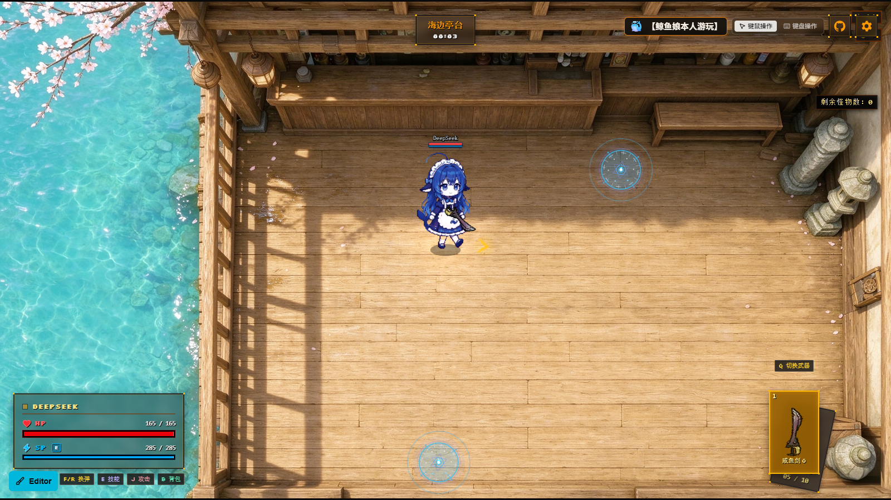
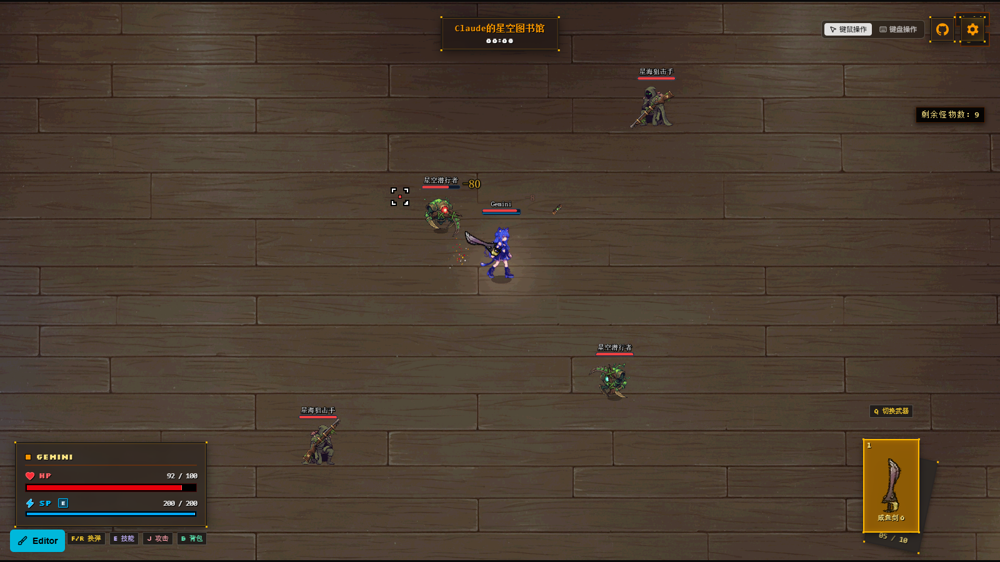
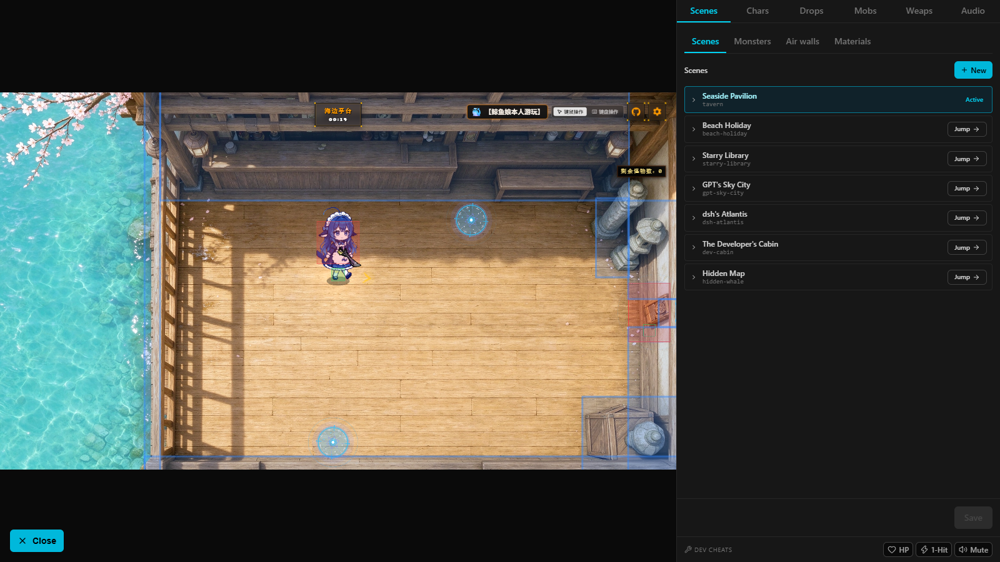

<p align="center">
  
</p>

<h1 align="center">深海回响 · 枪火柔情</h1>

<p align="center">
  <b>五个AI娘 · 一座海边亭台 · galgame 隐藏篇章里的三座世界，深海回响系列的射击篇章</b>
</p>

<p align="center">
  <a href="README.md">English</a> •
  <a href="README-CN.md">简体中文</a>
</p>

---

> [!IMPORTANT]
> **许可 —— 从 v1.3.0 起，上游模板的 MIT 许可不再适用于本项目。**
>
> - **代码** —— [PolyForm Noncommercial 1.0.0](./LICENSE)。源码可见、非商业：不得转售本项目，也不得用它做付费产品。
> - **内容**（美术、角色、剧情、音乐、关卡数据）—— [CC BY-NC-SA 4.0](./CONTENT-LICENSE.md)。欢迎二创、直播、录屏，**含平台广告分成**；不允许售卖。
>
> v1.2.5 及以前发出去的副本仍按当时的 MIT 授权（已授出的许可收不回来），v1.3.0 起的每次提交都是非商业。

> [!WARNING]
> **声明**：本项目为 **AI 辅助游戏开发与智能生成管线的探索实验项目 (AI Game Development Research Project)**。旨在验证 AI 驱动的数据驱动架构、像素美术生成与音效管线，**不建议直接部署在商业化生产环境**。

---

## 📖 项目简介 (Overview)

**深海回响 · 枪火柔情** 是「深海回响」系列的射击篇章：五位角色（DeepSeek、Claude、GPT、Qwen、Gemini）各带自己的武器、升级梯和主动技能。在**海边亭台**选一位，下**海滩假日**清场，赚到的钱带回亭台花掉。基于 Phaser 4 + React 19，数据全部走 YAML，引擎层面严格类型化。

**海边亭台是枢纽，不是商店菜单**：猫猫守着**猫猫商店**，柜台后面站着**神秘商人**，两人卖的东西进同一套升级梯。海滩只是第一站 —— 清完场，路就通向 galgame 隐藏篇章里的三座世界：**Claude的星空图书馆**、**GPT的天空之城**、**dsh的亚特兰蒂斯**。另有两条不在主线上的地图，来自 galgame 的番外，没有任何路标指过去。

## 🗺️ 世界一览 (Worlds)

| 顺序 | 关卡 id          | 地图                                          | 出处                             |
| :--- | :--------------- | :-------------------------------------------- | :------------------------------- |
| 枢纽 | `tavern`         | 海边亭台 — Seaside Pavilion                    | 选角、商店、升级梯、出关口        |
| 1    | `beach-holiday`  | 海滩假日 — Beach Holiday                       | 开场关：清完才能往下走            |
| 2    | `starry-library` | Claude的星空图书馆 — Claude's Starry Library   | galgame 隐藏章 · Claude          |
| 3    | `gpt-sky-city`   | GPT的天空之城 — GPT's Sky City                 | galgame 隐藏章 · GPT             |
| 4    | `dsh-atlantis`   | dsh的亚特兰蒂斯 — dsh's Atlantis               | galgame 隐藏章 · DSH             |
| 隐藏 | `dev-cabin`      | 开发者小屋 — The Developer's Cabin             | 打碎亭台墙上的画框走进去          |
| 隐藏 | `warhammer-redeem` | 战锤世界·来自群星的救赎                      | galgame 番外，34 页漫画           |

三座篇章地图都是 11008×6144 的整幅世界，由四块 5504×3072 的画拼接而成 —— 镜头从一个房间滚进下一个，没有门，也没有加载断点。

除了完整的游戏机制外，项目内置了**强大的可视化网页编辑器**。无需搭建传统的后端 API 服务器，项目直接通过 **Vite 本地开发插件 API (`vite/plugins/editor-api.mjs`)** 提供本地文件读写服务，支持直接在浏览器中绘制空气墙、放置怪物与传送门、裁剪 Sprite 精灵帧并一键持久化写回本地 YAML 数据文件。

---

## 🖼️ 游戏与编辑器截图 (Screenshots)

<p align="center">
  <br/>
  <i>加载界面 — 分层 WebGL 主视觉与进度条上的像素小人</i>
</p>

<p align="center">
  <br/>
  <i>海边亭台 — 多角色选角与属性雷达</i>
</p>

<p align="center">
  
  <br/>
  <i>左：关卡战斗与弹道层级 &nbsp;&nbsp;|&nbsp;&nbsp; 右：可视化在线关卡编辑器</i>
</p>

---

## 🤖 AI 服务与生成管线 (AI Services)

本项目深度集成了主流 AI 模型的生成管线，实现了从美术、配音到 BGM 的 AI 驱动开发：

| AI 服务                                  | 作用领域               | 接入与应用方式                                                                                        |
| :--------------------------------------- | :--------------------- | :---------------------------------------------------------------------------------------------------- |
| **Google Gemini** _(Gemini 3 Pro Image)_ | **像素美术图形**       | 资产 Prompt 模版位于 `prompts/`，通过 API 自动生成 chroma-key 像素精灵图落盘至 `public/assets/image/` |
| **MiniMax**                              | **BGM 背景音乐**       | 按照氛围 prompt 制作音乐，配乐产物与 `.prompt.json` 保存在 `public/assets/audio/`                     |
| **ElevenLabs**                           | **角色配音与战斗音效** | 生成角色受击/闪避独立语音与怪物/武器 SFX，通过 `scripts/elevenlabs-sfx.ts` 自动拉取                   |

---

## ✨ 核心特性 (Key Features)

### 🎮 游戏核心玩法 (Gameplay & Systems)

- **灵感参考 (Inspirations)**：借鉴 _Brotato (土豆兄弟)_ 的多武器走位射击与数值构建灵感。
- **选角与海边亭台枢纽**：五位 AI 娘各有自己的武器、技能梯、配音、雷达属性与伤害路由；海边亭台是枢纽——猫猫商店、神秘商人在此开店，存档也在这里写。
- **物理碰撞与怪物理性 AI**：基于 **Matter.js** 物理刚体碰撞，怪物具备僵直/受击状态机、脚底 BodyBox A* 寻路算法以及波次刷怪 Trigger 机制。
- **无缝传送门 (Teleporters)**：关卡间通过配置化的传送门碰撞点实现平滑数据传递与场景流转。
- **弹道与 Z 轴深度**：支持弹道重力/轨迹、武器 Swing / Orbit 轨迹与动态 Depth 层级管理。
- **动态加载界面**：分层 WebGL 主视觉（角色呼吸、草叶摇摆、拱门发光），进度条上有像素小人奔跑；不支持 WebGL 时退回静态图，竖屏手机自动横屏显示。

### 🛠️ 内置可视化关卡编辑器 (In-Browser Level Editor)

- 打开 `http://localhost:8080/?editor=1` 即可开启集成在游戏侧边的可视化编辑器。
- **无传统后端依赖**：直接依靠 Vite 本地 Node 插件端点 (`vite/plugins/editor-api.mjs`) 完成磁盘读写。
- **空气墙绘制 (Air Walls)**：Konva 叠加层多边形绘制，支持高墙 (Tall) / 低墙 (Short) 属性。
- **怪物与传送门配置 (Monsters & Teleporters)**：可视化放置怪物理性刷怪点、波次触发条件与传送门跳转目标。
- **Sprite & 素材模块编辑**：提供 Sprite 裁剪预览、材质贴图拼贴与完整属性表单，并持久化保存至 `public/data/` 目录下的 YAML 文件。

### ⚙️ 强校验数据驱动架构 (Data-Driven Architecture)

- 关卡 (`levels/`)、角色 (`characters/`)、怪物 (`monsters/`)、武器 (`weapons/`)、掉落物 (`drops/`)、音效 (`audios/`) 规则 **100% 由 YAML 驱动**。
- 每一个模块均配备严格的 **Zod Schema** 校验，保障游戏数据的高鲁棒性与离线可测试性。

---

## 📦 内容组织 — 一模块一目录 (Content Layout)

每个游戏模块在 `public/` 下都有一对平行目录：`data/` 存放 YAML 描述文件 (定义规则),`assets/` 存放 AI 生成的素材 (定义皮肤)。新增一只怪物、一把武器、一个掉落物、一张关卡、一个角色或一段音频,只需丢入一份 YAML + 它所引用的资源文件,**完全不需要修改 TypeScript 代码**。

```text
public/
├── data/                     # YAML 描述文件 (按模块分子目录)
│   ├── characters/           # 每个可玩角色一份 *.yaml
│   ├── monsters/             # 每只怪物一份 *.yaml (属性、体积框、sprite、动画、prompt)
│   ├── weapons/              # 每把武器一份 *.yaml (伤害、冷却、弹道)
│   ├── drops/                # 每个掉落物一份 *.yaml (贴图 + 效果)
│   ├── levels/               # index.yaml + 每张关卡一份 *.yaml (海边亭台、海滩、三座篇章世界…)
│   └── audios/
│       ├── music/            # 每首 BGM 一份 *.yaml (webm 源、淡入淡出、音量)
│       └── sfx/              # 每个 SFX 一份 *.yaml (源、音量、prompt 备注)
│
└── assets/                   # AI 生成的素材,目录命名与 data 一一对应
    ├── image/
    │   ├── characters/       # 色键抠图的角色 sprite 序列帧
    │   ├── monsters/         # 怪物 sprite 序列帧
    │   ├── weapons/          # 弹道 / 枪口贴图
    │   ├── drops/            # 掉落物图标
    │   ├── materials/        # 地图瓦片贴图
    │   ├── ui/               # HUD 图标、面板
    │   └── scenes/           # 关卡背景原画
    ├── audio/
    │   ├── music/            # .webm 背景音乐
    │   └── sfx/              # .wav / .mp3 一次性音效
    ├── font/                 # 像素字体
    └── lottie/               # Lottie JSON 动画
```

`data/` 与 `assets/` 目录刻意采用同名约定:例如 `data/monsters/keeper.yaml` 引用 `assets/image/monsters/keeper.png`。每个模块的资源加载、注册、动画驱动、清理逻辑都集中在自己的 `src/game/<module>/` 目录中 — 详见 [`docs/MODULES.md`](./docs/MODULES.md) 的 _YAML → Schema → Parser → Loader → Logic_ 模式。

---

## 🛠️ 技术栈 (Tech Stack)

| 架构层            | 技术方案                                                   | 说明                                                     |
| :---------------- | :--------------------------------------------------------- | :------------------------------------------------------- |
| **游戏引擎**      | [Phaser 4](https://github.com/phaserjs/phaser) + Matter.js | 渲染层、物理引擎、Sprite 动画与场景管理                  |
| **应用与 HUD UI** | [React 19](https://react.dev)                              | 交互式 HUD、亭台选角卡、设置菜单与关卡编辑器             |
| **本地 API 扩展** | [Vite 6](https://vite.dev) Dev Plugin API                  | 无需传统后端，本地 Vite 插件直接提供 YAML 文件持久化 API |
| **编程语言**      | [TypeScript 5.7](https://www.typescriptlang.org)           | 严格类型系统与全栈 Schema 约束                           |
| **状态与存档**    | [Zustand 5](https://github.com/pmndrs/zustand)             | HUD 状态推送到持久化 1Hz 存档写回                        |

---

## 🚀 快速开始 (Quick Start)

环境要求：**Node.js 18+**，推荐使用 **pnpm** 包管理器。

```bash
# 1. 安装依赖
pnpm install

# 2. 启动开发服务器 (同时提供游戏与本地 YAML 保存 API)
pnpm dev          # 启动游戏与开发服务器 (http://localhost:8080)
pnpm dev-nolog    # 启动开发服务器 (关闭匿名统计)

# 3. 生产打包
pnpm build        # 构建产物输出至 dist/
```

---

## 📁 项目结构 (Project Structure)

```text
ds-whale-shooter-PC/
├── public/
│   ├── assets/              # 静态资源 (图片、音效、像素字体)
│   └── data/                # 全量 YAML 游戏配置文件 (关卡/怪物/武器/角色/音效)
├── screenshots/             # 项目展示截图 (加载界面、战斗、亭台选角、关卡编辑器)
├── src/
│   ├── components/hud/      # React HUD 渲染组件 (血条、亭台、选角)
│   ├── editor/              # 可视化网页编辑器 React 组件
│   ├── game/                # Phaser 游戏核心逻辑 (场景、怪物、武器、物理)
│   ├── lib/                 # Schema 校验、数据 Parser、事件总线与通用逻辑
│   └── store/               # Zustand 游戏状态与 1Hz 自动存档
├── vite/plugins/            # 本地 Vite 开发 API 插件 (editor-api 文件写回端点)
└── docs/                    # 完整的技术设计与模块文档
```

---

## 📚 详细文档 (Documentation)

项目拥有极为完善的模块化技术文档，存放在 [`docs/`](./docs) 目录下：

- 📘 [`docs/SCENES.md`](./docs/SCENES.md) — 场景加载流程、传送门关卡流转与海边亭台枢纽。
- 📘 [`docs/BOOT-LOADING.md`](./docs/BOOT-LOADING.md) — 动态加载界面：分层、遮罩、动效、进度条与像素小人。
- 📘 [`docs/EDITOR.md`](./docs/EDITOR.md) — 可视化关卡编辑器功能划分与 Vite 本地持久化 API。
- 📘 [`docs/MODULES.md`](./docs/MODULES.md) — YAML → Schema → Parser → Loader → Logic 统一设计模式。
- 📘 [`docs/SKILL.md`](./docs/SKILL.md) — 关卡数据维护规范、数值平衡计算与 AI 生成管线。
- 📙 模块设计：[`MONSTERS.md`](./docs/MONSTERS.md) · [`WEAPONS.md`](./docs/WEAPONS.md) · [`CHARACTERS.md`](./docs/CHARACTERS.md) · [`DROPS.md`](./docs/DROPS.md) · [`AUDIOS.md`](./docs/AUDIOS.md) · [`PERSIST.md`](./docs/PERSIST.md)

---

## 📄 许可证 (License)

本项目基于 [MIT 许可证](./LICENSE) 开源。

> 原始 Phaser + React + TypeScript 模板版权 © Phaser Studio Inc.，基于 MIT 协议授权。
